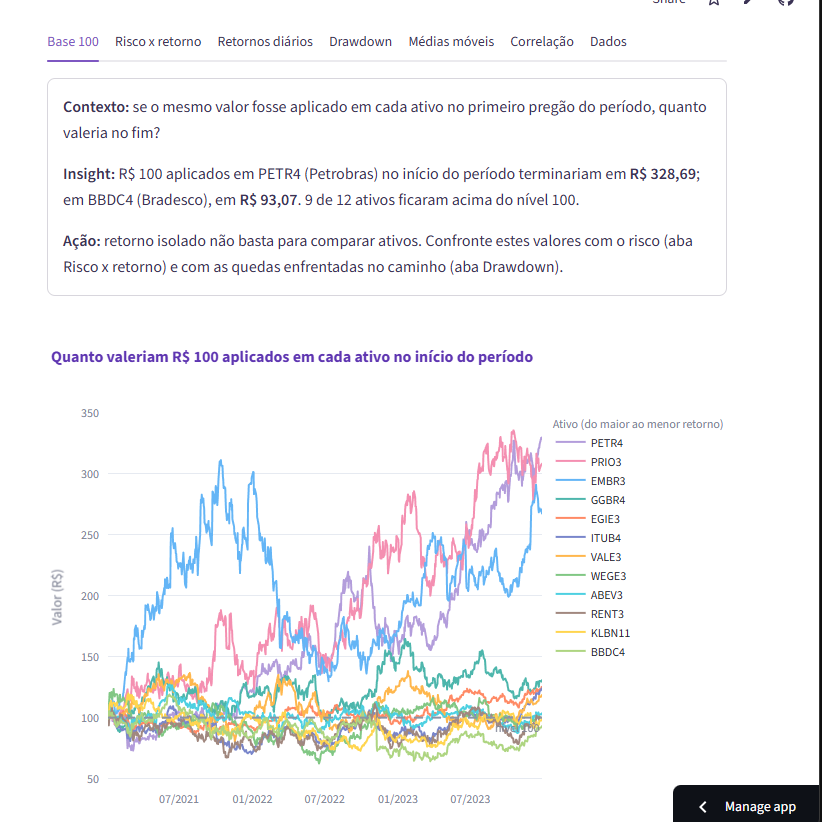
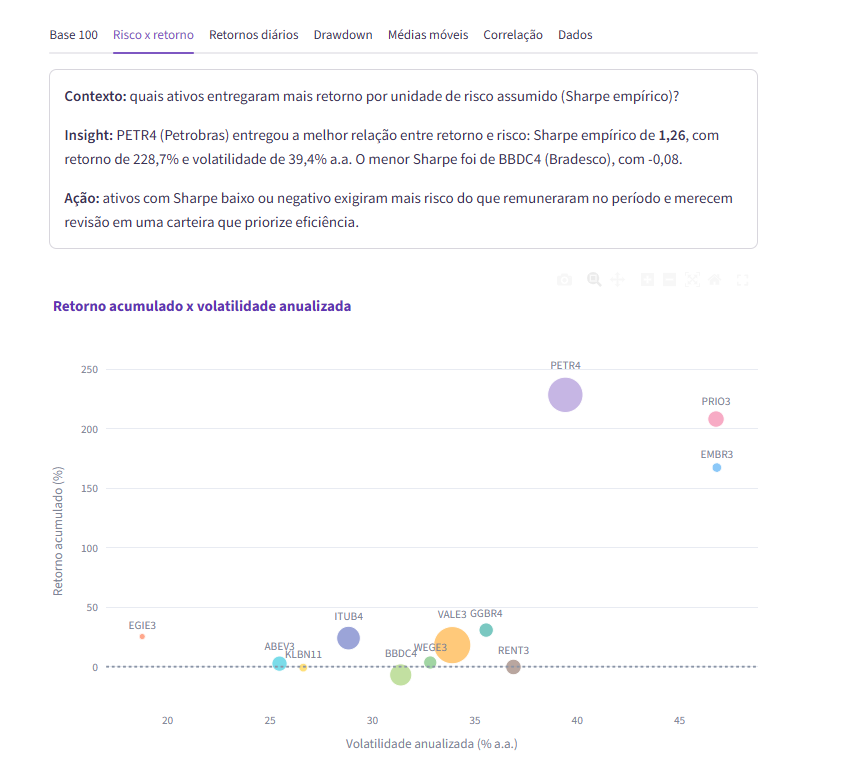
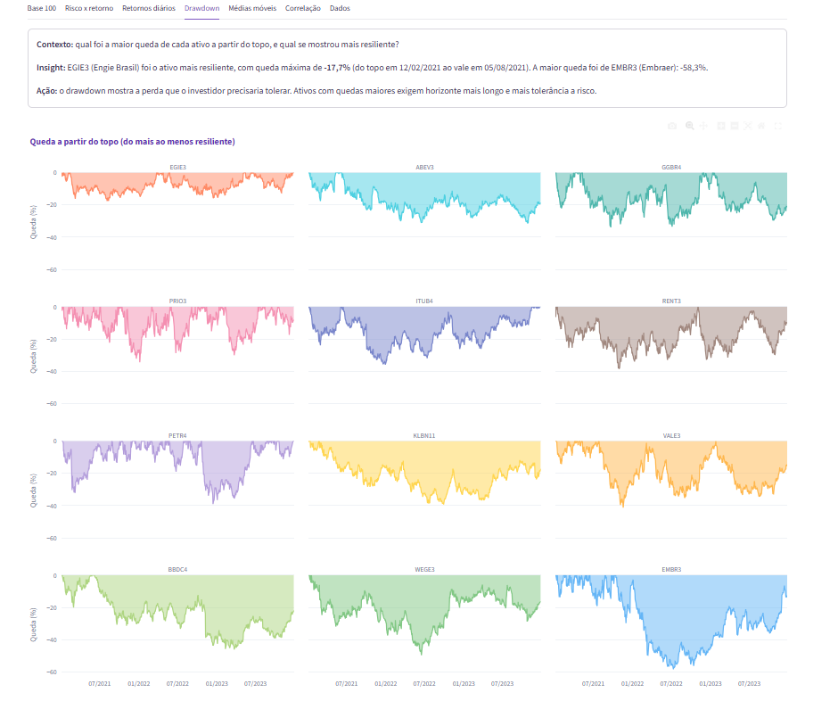
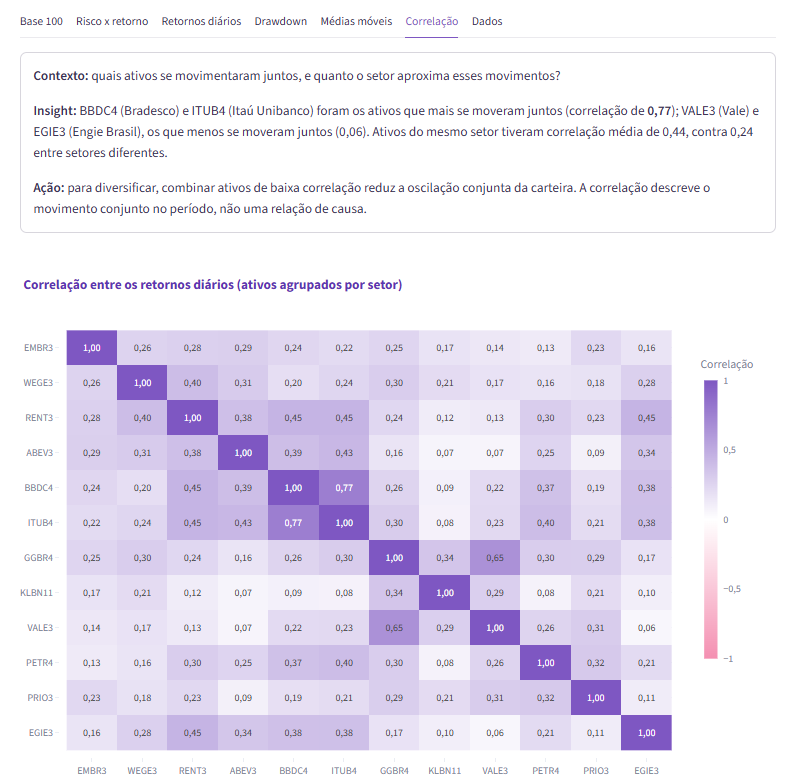
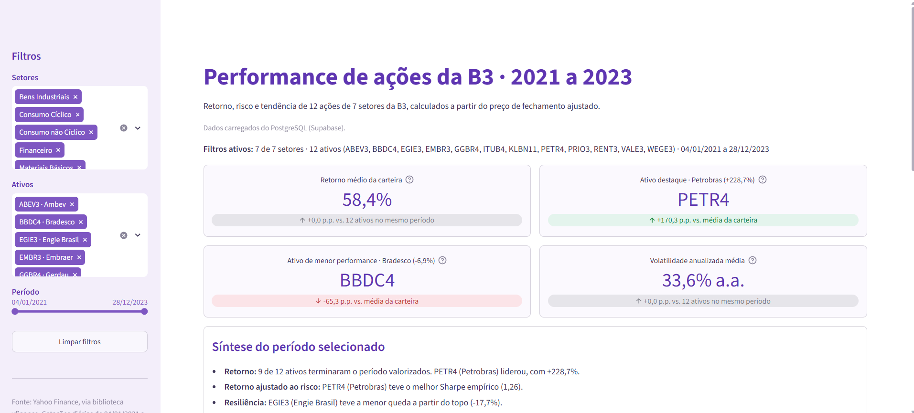
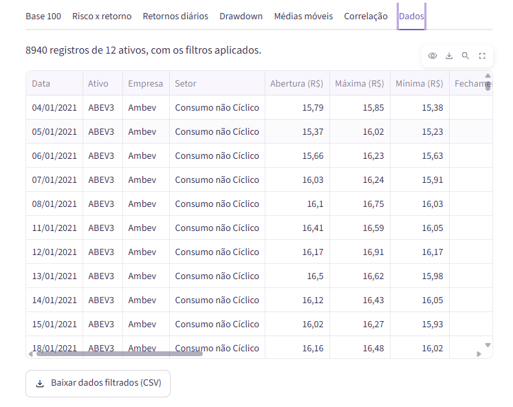
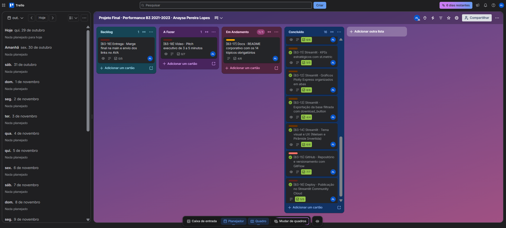

# Performance de Ações da B3 · 2021 a 2023

**Projeto Avaliativo Final · Módulo 2**
Visualização de Dados e Business Intelligence (SENAI/SC)
**Aluna:** Anaysa Pereira Lopes

Pipeline de dados e Data App em Streamlit que comparam retorno, risco e
tendência de **12 ações da B3** entre 2021 e 2023, a partir de **8.940
cotações diárias** (745 pregões por ativo), tratadas em camadas e carregadas
em um banco PostgreSQL na nuvem.

**App publicado:** https://b3-performance-acoes.streamlit.app\
**Quadro do projeto no Trello:** https://trello.com/b/bgB6llaf/projeto-final-performance-b3-2021-2023-anaysa-pereira-lopes

---

## Sumário

1. [Título e resumo executivo](#1-título-e-resumo-executivo)
2. [Contexto de negócio e pergunta orientadora](#2-contexto-de-negócio-e-pergunta-orientadora)
3. [Fonte dos dados e licença](#3-fonte-dos-dados-e-licença)
4. [Pipeline de engenharia de dados](#4-pipeline-de-engenharia-de-dados)
5. [Dicionário de dados](#5-dicionário-de-dados)
6. [Tecnologias e bibliotecas](#6-tecnologias-e-bibliotecas)
7. [Principais resultados e evidências numéricas](#7-principais-resultados-e-evidências-numéricas)
8. [Discussão e limitações da análise](#8-discussão-e-limitações-da-análise)
9. [Aplicação profissional e decisões de negócio](#9-aplicação-profissional-e-decisões-de-negócio)
10. [Demonstração do Data App](#10-demonstração-do-data-app)
11. [Como executar localmente](#11-como-executar-localmente)
12. [Estrutura de pastas](#12-estrutura-de-pastas)
13. [Gestão ágil e links do projeto](#13-gestão-ágil-e-links-do-projeto)
14. [Autoria e créditos](#14-autoria-e-créditos)

---

## 1. Título e resumo executivo

**Performance de Ações da B3 · 2021 a 2023** é uma solução de análise de
mercado de capitais que acompanha a evolução histórica de 12 ações líquidas
da bolsa brasileira, de 7 setores diferentes, ao longo de três anos completos
de pregões.

O projeto vai da coleta das cotações até um painel interativo publicado na
nuvem. No caminho, os dados passam por três camadas de tratamento (Bronze,
Prata e Ouro), viram um modelo estrela no PostgreSQL e alimentam um Data App
em Streamlit com filtros, indicadores e gráficos.

Os principais resultados do período:

- **9 dos 12 ativos** terminaram 2023 valendo mais do que no início de 2021.
  O retorno médio da carteira, com o mesmo valor aplicado em cada ação, foi de
  **58,4%**.
- **PETR4** foi o destaque: R$ 100 viraram **R$ 328,69**, com o melhor Sharpe
  empírico da amostra (**1,26**).
- **EGIE3** foi o ativo mais estável: menor volatilidade (**18,8% a.a.**) e
  menor queda a partir do topo (**-17,7%**).
- **BBDC4** teve o pior resultado: **-6,9%** no período.

---

## 2. Contexto de negócio e pergunta orientadora

Quem precisa escolher entre ações costuma olhar primeiro para quanto cada uma
subiu. Esse número, sozinho, engana de dois jeitos. Ações têm preços muito
diferentes entre si, então comparar cotações diretamente não diz quem rendeu
mais. E um retorno alto pode ter vindo junto com oscilações fortes e quedas
longas, que nem todo investidor aguentaria até o fim.

Este projeto organiza essa comparação de forma justa: todos os ativos partem
do mesmo ponto (Base 100), o retorno é colocado lado a lado com o risco, e as
quedas a partir do topo ficam visíveis. A pergunta que guia o trabalho é:

> **Entre 2021 e 2023, quais das 12 ações analisadas entregaram o melhor
> retorno para o risco que cobraram do investidor, e quais mostraram mais
> resiliência nas quedas?**

Dessa pergunta saem as cinco perguntas de negócio que o Data App responde, uma
em cada aba:

| # | Pergunta | Onde é respondida |
|---|----------|-------------------|
| P1 | Se um investidor aplicasse o mesmo valor em cada ativo no início de 2021, quanto teria no fim de 2023 (Base 100)? | Aba **Base 100** |
| P2 | Quais ativos entregaram a melhor relação entre retorno e risco (Sharpe empírico)? | Aba **Risco x retorno** |
| P3 | Como se comportam os retornos diários (dispersão, assimetria e caudas)? | Aba **Retornos diários** |
| P4 | Qual foi a maior queda de cada ativo a partir do topo, e qual foi o mais resiliente? | Aba **Drawdown** |
| P5 | Como os preços se comportaram frente às médias móveis de 21 e 50 pregões? | Aba **Médias móveis** |

As perguntas completas, com as histórias de usuário, estão em
[`docs/perguntas_de_negocio.md`](docs/perguntas_de_negocio.md). Como apoio,
o app também mostra a **correlação** entre os ativos e o peso do setor nesses
movimentos.

---

## 3. Fonte dos dados e licença

| Item | Detalhe |
|------|---------|
| Origem | Yahoo Finance, por meio da biblioteca **yfinance** (API pública, ativos com sufixo `.SA`) |
| Período | 01/01/2021 a 31/12/2023 (primeiro pregão em 04/01/2021 e último em 28/12/2023) |
| Frequência | Diária, 745 pregões por ativo |
| Variáveis | Data, abertura, máxima, mínima, fechamento, fechamento ajustado, volume, dividendos e desdobramentos |
| Volume da base | 8.940 registros (12 ativos x 745 pregões) |
| Data da extração | 23/10/2026 |
| Licença | Dados de uso pessoal e educacional, conforme os termos de uso do Yahoo Finance. A biblioteca yfinance é distribuída sob a licença Apache 2.0 |

**Ativos analisados**, com a classificação setorial da B3:

| Ativo | Empresa | Setor |
|-------|---------|-------|
| PETR4 | Petrobras | Petróleo, Gás e Biocombustíveis |
| PRIO3 | PRIO | Petróleo, Gás e Biocombustíveis |
| VALE3 | Vale | Materiais Básicos |
| GGBR4 | Gerdau | Materiais Básicos |
| KLBN11 | Klabin | Materiais Básicos |
| WEGE3 | WEG | Bens Industriais |
| EMBR3 | Embraer | Bens Industriais |
| ITUB4 | Itaú Unibanco | Financeiro |
| BBDC4 | Bradesco | Financeiro |
| EGIE3 | Engie Brasil | Utilidade Pública |
| ABEV3 | Ambev | Consumo não Cíclico |
| RENT3 | Localiza | Consumo Cíclico |

Usei a classificação setorial oficial da B3, por isso os 12 ativos ficam
distribuídos em 7 setores.

A Embraer passou a negociar com o código **EMBJ3** em 03/11/2025, e o Yahoo
Finance mantém o histórico só no código novo. Por isso a extração consulta
`EMBJ3.SA`, mas o projeto mantém **EMBR3**, que era o código vigente no período
analisado.

---

## 4. Pipeline de engenharia de dados

O pipeline segue a arquitetura em camadas trabalhada no módulo. Cada etapa é
um script Python independente, que lê a camada anterior e grava a seguinte,
sempre com caminhos relativos à raiz do projeto.

```
yfinance (API)
   ↓  src/extracao.py
BRONZE   data/bronze/   dado bruto, exatamente como veio da fonte
   ↓  src/tratamento.py
PRATA    data/prata/    dado limpo, padronizado e validado
   ↓  src/indicadores.py
OURO     data/ouro/     modelo estrela e indicadores calculados
   ↓  src/carga_banco.py
PostgreSQL (Supabase)   fato_cotacoes + dim_ativos
   ↓
Data App (Streamlit)
```

### 4.1. Extração (camada Bronze)

[`src/extracao.py`](src/extracao.py) baixa o histórico diário de cada ativo com
`yfinance`, usando `auto_adjust=False` para manter as duas colunas de preço: o
fechamento original e o **fechamento ajustado** por proventos e desdobramentos.
Para respeitar os limites da API, o script faz uma pausa de 2 segundos entre os
ativos e tenta até três vezes em caso de falha. O resultado é gravado sem
nenhuma alteração, só com três colunas de controle: o código do ativo, o
símbolo consultado e a data da extração.

### 4.2. Tratamento (camada Prata)

[`src/tratamento.py`](src/tratamento.py) aplica a limpeza em etapas numeradas e
registra cada uma em
[`docs/relatorios/relatorio_tratamento.txt`](docs/relatorios/relatorio_tratamento.txt).

| Etapa | O que foi feito | Resultado |
|-------|-----------------|-----------|
| Encoding | Leitura e gravação em UTF-8 e busca por caracteres corrompidos | 0 valores corrompidos |
| Nomes de colunas | Padronização com prefixos (`dt_`, `cd_`, `nm_`, `ds_`, `vl_`, `qt_`, `pc_`, `fg_`) | 12 colunas renomeadas |
| Datas | Conversão para datetime no fuso de Brasília, guardando só a data | 0 datas inválidas |
| Período | Conferência do recorte de 01/01/2021 a 31/12/2023 | 0 linhas fora do período |
| Tipos numéricos | Preços em decimal (`float64`) e volume em inteiro (`Int64`) | 0 valores não numéricos |
| Nulos | Contagem por coluna, sem preenchimento artificial | 0 nulos |
| Duplicados | Chave ativo + data | 0 repetições |
| Preços inválidos | Busca por preços menores ou iguais a zero | 0 linhas |
| Consistência OHLC | Máxima e mínima coerentes com abertura e fechamento | 0 linhas incoerentes |
| Sinalizações | Volume zero e variação diária acima de 15% | 3 e 6 pregões, **mantidos e sinalizados** |
| Colunas derivadas | Empresa, setor e volume financeiro (fechamento x volume) | 3 colunas novas |

**Bronze: 8.940 linhas. Prata: 8.940 linhas. Perda: 0.**

Uma decisão importante foi **não apagar nem preencher** registros atípicos. Os
3 pregões com volume zero (BBDC4 em 02/06/2023, PRIO3 e WEGE3 em 26/09/2022)
repetem o preço do dia anterior, um padrão típico de falha de registro na
fonte. As 6 variações acima de 15% são movimentos reais de mercado e fazem
parte do risco que o projeto mede. Os dois casos ficaram na base, marcados nas
colunas `fg_volume_zero` e `fg_variacao_extrema`, e foram documentados como
limitação.

### 4.3. Indicadores (camada Ouro)

[`src/indicadores.py`](src/indicadores.py) calcula os indicadores sempre sobre
o **fechamento ajustado**, para que dividendos e desdobramentos não distorçam
o retorno.

| Indicador | Regra de cálculo |
|-----------|------------------|
| Retorno diário | preço(t) ÷ preço(t−1) − 1 |
| Base 100 | preço ÷ preço do primeiro pregão × 100 |
| Retorno acumulado | preço final ÷ preço inicial − 1 |
| Retorno anualizado | (1 + acumulado) ^ (252 ÷ nº de pregões) − 1 |
| Volatilidade anualizada | desvio padrão dos retornos diários × √252 |
| Sharpe empírico | retorno anualizado ÷ volatilidade anualizada, sem taxa livre de risco |
| Drawdown | preço ÷ maior preço até a data − 1 |
| SMA 21 e SMA 50 | média dos últimos 21 e 50 fechamentos ajustados |
| Correlação | coeficiente de Pearson entre os retornos diários de cada par de ativos |

As médias móveis são calculadas sobre o histórico completo, antes de qualquer
filtro, para que não fiquem vazias quando o usuário escolhe um período mais
curto no app. Os resultados por pergunta de negócio ficam em
[`docs/relatorios/relatorio_indicadores.txt`](docs/relatorios/relatorio_indicadores.txt).

### 4.4. Modelagem dimensional e banco de dados

A camada Ouro é um **modelo estrela** com uma tabela fato e uma dimensão:

```
dim_ativos (12 linhas)                 fato_cotacoes (8.940 linhas)
──────────────────────                 ────────────────────────────
cd_ticker  (PK) ─────────────────────► cd_ticker  (FK) ┐ PK composta
nm_empresa                             dt_pregao       ┘
ds_setor                               preços, volumes, retorno,
cd_simbolo_yahoo                       médias móveis e sinalizações
```

A estrutura é criada por [`src/sql/01_criar_tabelas.sql`](src/sql/01_criar_tabelas.sql),
com chave primária, chave estrangeira e índice por data. A carga no PostgreSQL
(Supabase) é feita por [`src/carga_banco.py`](src/carga_banco.py), que lê as
credenciais do arquivo `.streamlit/secrets.toml` (fora do repositório) e, no
final, confere se o número de linhas no banco é igual ao dos arquivos.

As consultas de [`src/sql/02_consultas_validacao.sql`](src/sql/02_consultas_validacao.sql)
validam a carga direto no banco: pregões e período por ativo, integridade entre
fato e dimensão, retorno acumulado com funções de janela, volatilidade
anualizada e volume financeiro médio por setor.

### 4.5. Análise exploratória

O notebook [`notebooks/analise_exploratoria.ipynb`](notebooks/analise_exploratoria.ipynb)
reúne a conferência da qualidade da base e a primeira leitura de cada pergunta
de negócio, com os gráficos e os principais resultados de cada seção. Ele usa
as mesmas funções de `src/indicadores.py` que o app, então os números são
idênticos nos dois.

---

## 5. Dicionário de dados

Principais colunas da tabela fato e da dimensão, usadas pelo Data App:

| Coluna | Tipo (pandas / PostgreSQL) | Significado financeiro |
|--------|----------------------------|------------------------|
| `dt_pregao` | `datetime64` / `DATE` | Dia de negociação na B3 |
| `cd_ticker` | `str` / `VARCHAR(10)` | Código do ativo na bolsa |
| `nm_empresa` | `str` / `VARCHAR(60)` | Nome da companhia |
| `ds_setor` | `str` / `VARCHAR(60)` | Setor econômico, pela classificação da B3 |
| `vl_abertura` | `float64` / `DOUBLE PRECISION` | Primeiro preço do dia (R$) |
| `vl_maxima` | `float64` / `DOUBLE PRECISION` | Maior preço do dia (R$) |
| `vl_minima` | `float64` / `DOUBLE PRECISION` | Menor preço do dia (R$) |
| `vl_fechamento` | `float64` / `DOUBLE PRECISION` | Último preço do dia, sem ajuste (R$) |
| `vl_fechamento_ajustado` | `float64` / `DOUBLE PRECISION` | Fechamento corrigido por dividendos, JCP e desdobramentos (R$). Base de todos os indicadores |
| `qt_volume_acoes` | `int64` / `BIGINT` | Quantidade de ações negociadas no dia |
| `vl_volume_financeiro` | `float64` / `DOUBLE PRECISION` | Valor negociado no dia, estimado por fechamento x volume (R$) |
| `vl_retorno_diario` | `float64` / `DOUBLE PRECISION` | Variação em relação ao pregão anterior (0,05 = 5%) |
| `vl_sma_21` | `float64` / `DOUBLE PRECISION` | Média móvel simples de 21 pregões, tendência de curto prazo (R$) |
| `vl_sma_50` | `float64` / `DOUBLE PRECISION` | Média móvel simples de 50 pregões, tendência de médio prazo (R$) |
| `fg_volume_zero` | `int64` / `SMALLINT` | 1 quando o pregão veio com volume zero e preço repetido |
| `fg_variacao_extrema` | `int64` / `SMALLINT` | 1 quando a variação diária passou de 15% |

O dicionário completo, com as colunas das camadas Bronze e Prata, do resumo por
ativo e as regras de cálculo de cada indicador, está em
[`docs/dicionario_de_dados.md`](docs/dicionario_de_dados.md).

---

## 6. Tecnologias e bibliotecas

| Ferramenta | Uso no projeto | Por que escolhi |
|------------|----------------|-----------------|
| Python 3.13 | Todo o pipeline e o app | Linguagem trabalhada no curso, com bibliotecas maduras para dados |
| pandas e NumPy | Limpeza, tipagem e cálculo dos indicadores | Padrão de mercado para dados tabulares e séries temporais |
| yfinance | Extração das cotações | Acesso gratuito ao histórico diário da B3 com fechamento ajustado |
| PostgreSQL (Supabase) | Banco da camada Ouro na nuvem | Banco relacional gratuito, acessível pelo app publicado |
| SQLAlchemy e psycopg2 | Conexão do Python com o PostgreSQL | Usados tanto na carga quanto pelo `st.connection` do Streamlit |
| SQL | Criação das tabelas e consultas de validação | Conferir a carga direto no banco, sem depender do Python |
| Streamlit | Data App | Transforma scripts Python em app web com filtros, cache e abas |
| Plotly Express | Gráficos do app e do notebook | Gráficos interativos com zoom, legenda clicável e tooltip |
| Jupyter Notebook | Análise exploratória | Junta código, gráficos e explicação no mesmo documento |
| Streamlit Community Cloud | Publicação do app | Deploy gratuito integrado ao GitHub |
| Git e GitHub | Versionamento | Histórico por funcionalidade, com branches e pull requests |
| Trello | Gestão do projeto | Quadro Kanban para planejar e acompanhar as tarefas |

---

## 7. Principais resultados e evidências numéricas

Os números abaixo consideram o período completo, de 04/01/2021 a 28/12/2023.
No app, todos são recalculados conforme os filtros escolhidos.

### 7.1. Rentabilidade normalizada (Base 100)

| Ativo | R$ 100 viraram | Retorno acumulado | Retorno ao ano |
|-------|----------------|-------------------|----------------|
| PETR4 | R$ 328,69 | 228,7% | 49,6% |
| PRIO3 | R$ 308,32 | 208,3% | 46,4% |
| EMBR3 | R$ 267,50 | 167,5% | 39,6% |
| GGBR4 | R$ 130,79 | 30,8% | 9,5% |
| EGIE3 | R$ 125,35 | 25,3% | 8,0% |
| ITUB4 | R$ 124,02 | 24,0% | 7,6% |
| VALE3 | R$ 118,11 | 18,1% | 5,8% |
| WEGE3 | R$ 103,51 | 3,5% | 1,2% |
| ABEV3 | R$ 102,57 | 2,6% | 0,9% |
| RENT3 | R$ 99,75 | -0,3% | -0,1% |
| KLBN11 | R$ 99,20 | -0,8% | -0,3% |
| BBDC4 | R$ 93,07 | -6,9% | -2,4% |

O resultado foi muito concentrado. Só três ativos passaram de R$ 200, e os dois
primeiros são do mesmo setor (petróleo). A maioria ficou entre R$ 99 e R$ 131,
e três terminaram abaixo do valor aplicado. Isso mostra por que o retorno médio
da carteira (58,4%) não representa o ativo típico: ele é puxado para cima pelos
três primeiros.



### 7.2. Retorno ajustado ao risco

| Ativo | Sharpe empírico | Volatilidade anualizada | Retorno acumulado |
|-------|-----------------|-------------------------|-------------------|
| PETR4 | 1,26 | 39,4% | 228,7% |
| PRIO3 | 0,99 | 46,8% | 208,3% |
| EMBR3 | 0,84 | 46,8% | 167,5% |
| EGIE3 | 0,42 | 18,8% | 25,3% |
| GGBR4 | 0,27 | 35,6% | 30,8% |
| ITUB4 | 0,26 | 28,8% | 24,0% |
| VALE3 | 0,17 | 33,9% | 18,1% |
| WEGE3 | 0,04 | 32,8% | 3,5% |
| ABEV3 | 0,03 | 25,5% | 2,6% |
| RENT3 | 0,00 | 36,9% | -0,3% |
| KLBN11 | -0,01 | 26,6% | -0,8% |
| BBDC4 | -0,08 | 31,4% | -6,9% |

PETR4 entregou o maior retorno por unidade de risco. PRIO3 e EMBR3 também
renderam muito, mas foram os ativos mais voláteis da amostra (46,8% a.a.), o
que diminui a vantagem deles no Sharpe. O caso mais interessante é o da EGIE3:
com retorno moderado e a menor volatilidade de todas, ficou em 4º lugar no
Sharpe, à frente de ativos que renderam mais. RENT3, KLBN11 e BBDC4 tiveram
Sharpe zero ou negativo, ou seja, assumiram risco sem compensação no período.



### 7.3. Comportamento dos retornos diários

- **Todos os 12 ativos** têm curtose positiva: dias extremos aconteceram com
  mais frequência do que uma distribuição normal preveria.
- **ITUB4 (13,49), BBDC4 (8,99) e PETR4 (7,63)** têm as caudas mais pesadas, e
  são os únicos com assimetria negativa. Neles, as quedas extremas foram mais
  intensas do que as altas extremas (pior dia: -17,96%, -17,38% e -20,71%).
- **EGIE3** tem a menor oscilação típica (desvio padrão de 1,18% ao dia) e o
  pior dia mais brando da amostra (-4,75%).

No caso do ITUB4, esse resultado depende de um único pregão: a queda de 17,96%
em 04/10/2021, primeiro pregão após a data de corte da cisão da participação do
Itaú na XP. Recalculando sem esse dia, a curtose cai de 13,49 para **1,48** e a
assimetria passa de -1,11 para **+0,21**. Esse ponto é discutido na seção 8.

### 7.4. Drawdown máximo

| Ativo | Maior queda | Do topo em | Ao vale em |
|-------|-------------|------------|------------|
| EGIE3 | -17,7% | 12/02/2021 | 05/08/2021 |
| ABEV3 | -31,4% | 07/06/2021 | 27/10/2023 |
| GGBR4 | -33,9% | 11/05/2021 | 21/09/2021 |
| PRIO3 | -34,3% | 14/10/2021 | 05/01/2022 |
| ITUB4 | -35,9% | 16/06/2021 | 30/12/2021 |
| RENT3 | -38,4% | 14/01/2021 | 29/10/2021 |
| PETR4 | -39,1% | 21/10/2022 | 14/12/2022 |
| KLBN11 | -39,3% | 24/02/2021 | 29/09/2022 |
| VALE3 | -41,3% | 28/07/2021 | 18/11/2021 |
| BBDC4 | -46,0% | 07/06/2021 | 23/03/2023 |
| WEGE3 | -49,5% | 18/01/2021 | 17/06/2022 |
| EMBR3 | -58,3% | 14/10/2021 | 11/07/2022 |

EGIE3 foi o ativo mais resiliente. O contraste mais forte é o da EMBR3: mesmo
terminando o período com +167,5%, chegou a perder 58,3% entre outubro de 2021
e julho de 2022. Quem tivesse entrado no topo precisaria aguentar essa queda
para chegar ao resultado final. Retorno alto não significa caminho tranquilo.



### 7.5. Preço frente às médias móveis

- **PETR4** fechou acima da SMA 50 em **72,3%** dos pregões, a tendência de alta
  mais consistente da amostra, seguida de PRIO3 (65,4%).
- **KLBN11** ficou acima da média em só **40,8%** dos pregões.
- **EGIE3** teve o maior número de cruzamentos entre a SMA 21 e a SMA 50 (**23**),
  o que indica um preço sem tendência prolongada, coerente com a baixa
  volatilidade.

### 7.6. Correlação e setores

- Os pares mais correlacionados são do mesmo setor: **BBDC4 x ITUB4 (0,77)** e
  **GGBR4 x VALE3 (0,65)**.
- Ativos do mesmo setor tiveram correlação média de **0,44**, contra **0,24**
  entre setores diferentes.
- Os pares menos correlacionados ficaram perto de zero, como **EGIE3 x VALE3
  (0,06)**.

Isso quer dizer que os preços desses pares oscilaram juntos no período, e não
que o movimento de um causou o do outro.



### 7.7. Leitura por ano

| Ano | Retorno médio | Volatilidade média | Melhor ativo | Pior ativo |
|-----|---------------|--------------------|--------------|------------|
| 2021 | 16,0% | 37,5% a.a. | EMBR3 (+196,5%) | ITUB4 (-29,8%) |
| 2022 | 12,5% | 35,1% a.a. | PRIO3 (+83,4%) | EMBR3 (-43,3%) |
| 2023 | 27,2% | 27,1% a.a. | PETR4 (+110,4%) | GGBR4 (-9,6%) |

O ranking muda bastante de um ano para outro. A EMBR3 foi a melhor de 2021 e a
pior de 2022. Em 2023, a carteira teve o maior retorno médio com a menor
volatilidade dos três anos.

---

## 8. Discussão e limitações da análise

**O que os dados permitem afirmar:** como cada ativo se comportou entre 2021 e
2023 em retorno, risco, quedas e tendência, e quais ativos oscilaram juntos.

**O que os dados não permitem afirmar:**

- **Causa.** O projeto não testa por que um ativo subiu ou caiu. Correlação
  entre ativos e coincidência de datas não comprovam relação de causa e efeito.
- **Futuro.** Os resultados descrevem um período específico e não são previsão
  nem recomendação de investimento. A leitura por ano mostra como o ranking
  muda rápido.
- **O mercado como um todo.** São 12 ações de grande porte, com 1 a 3 ativos
  por setor. A média de um setor com um único ativo é, na prática, o resultado
  de uma empresa.

**Limitações técnicas:**

- **Sharpe sem taxa livre de risco.** O Sharpe empírico serve para comparar os
  ativos entre si. Descontando a taxa livre de risco do período, todos os
  valores seriam menores.
- **Cisão não ajustada.** O fechamento ajustado do Yahoo Finance corrige
  dividendos e desdobramentos, mas não cisões. Por isso a queda de 17,96% da
  ITUB4 em 04/10/2021 aparece como perda, embora parte desse valor tenha sido
  transferida aos acionistas na cisão. O registro foi mantido e sinalizado, e o
  efeito dele nas estatísticas está medido na seção 7.3.
- **Falhas de registro na fonte.** Três pregões vieram com volume zero e preço
  repetido. Foram mantidos e sinalizados.
- **Volume financeiro estimado.** É calculado por fechamento x quantidade de
  ações, não pelo valor exato negociado.
- **Carteira sem custos.** O retorno da carteira supõe o mesmo valor em cada
  ativo, sem rebalanceamento, corretagem ou impostos.
- **Mudança de código.** O histórico da Embraer vem do código atual (EMBJ3),
  como explicado na seção 3.

---

## 9. Aplicação profissional e decisões de negócio

O painel foi pensado para quem precisa comparar ações antes de decidir, como um
investidor pessoa física, um analista de investimentos ou um gestor que
acompanha uma carteira. Na prática, ele apoia decisões como:

- **Comparar ativos pelo retorno ajustado ao risco**, e não só pelo retorno.
  Dois ativos com retorno parecido podem ter exigido riscos muito diferentes.
- **Dimensionar a tolerância a perdas.** O drawdown mostra a maior queda que
  quem investiu teria enfrentado, o que ajuda a definir quanto alocar em cada
  ativo.
- **Montar uma carteira mais diversificada.** A correlação mostra quais ativos
  tendem a oscilar juntos. Combinar pares de baixa correlação reduz a oscilação
  do conjunto.
- **Testar períodos específicos.** Com os filtros, dá para repetir toda a
  análise só para 2022, só para um setor ou só para um grupo de ativos, e ver
  como as conclusões mudam.
- **Levar os dados para outra análise.** A aba Dados exporta exatamente o que
  está filtrado, em CSV pronto para o Excel.

Em todos os casos, o painel apoia a análise, mas não substitui a avaliação dos
fundamentos de cada empresa nem o perfil de risco de quem investe.

---

## 10. Demonstração do Data App

**Link público:** https://b3-performance-acoes.streamlit.app

### Capturas de tela

| Visão geral | Base 100 |
|-------------|----------|
|  |  |

| Risco x retorno | Drawdown |
|-----------------|----------|
|  |  |

| Correlação | Dados e exportação |
|------------|--------------------|
|  |  |

### Guia de navegação

A tela segue a lógica da pirâmide invertida: primeiro o resumo, depois o
detalhe.

1. **Barra lateral (filtros):** escolha setores, ativos e período. A lista de
   ativos se ajusta aos setores escolhidos, e o botão **Limpar filtros** volta
   tudo ao estado inicial.
2. **Indicadores no topo:** retorno médio da carteira, ativo destaque, ativo
   de menor performance e volatilidade anualizada média. O retorno médio e a
   volatilidade são comparados com a média dos 12 ativos no mesmo período, e
   os ativos destaque e de menor performance, com a média da carteira
   filtrada. O ícone **?** de cada cartão explica o cálculo.
3. **Síntese do período selecionado:** as principais conclusões e uma
   orientação de uso, recalculadas a cada filtro.
4. **Abas de análise:** cada aba responde a uma pergunta de negócio em três
   partes (**Contexto, Insight e Ação**), seguidas do gráfico e de uma tabela
   de ranking. Nos gráficos, passe o mouse para ver os valores e clique na
   legenda para esconder ou isolar um ativo.
5. **Aba Dados:** a base filtrada em tabela e o botão para baixar em CSV.
6. **Sobre os dados e a metodologia:** fonte, fórmulas e limitações, no fim da
   página.

### Recursos técnicos

| Recurso | Como foi implementado |
|---------|-----------------------|
| Conexão resiliente | `st.connection("postgresql", type="sql")` com `try/except`. Se o banco estiver indisponível, o app carrega a cópia em CSV da camada Ouro e avisa na tela |
| Segurança de credenciais | `.streamlit/secrets.toml` fora do repositório pelo `.gitignore`. No Streamlit Cloud, as credenciais ficam nos Secrets do app |
| Cache | `@st.cache_data` com `ttl` de 1 hora na consulta ao banco, no cálculo dos indicadores, na correlação e na geração do CSV |
| Estado e filtros | `st.session_state` guarda os filtros de setor, ativo e período, com botão de reset |
| KPIs | 4 cartões com `st.columns` e `st.metric`, todos com delta de comparação em pontos percentuais |
| Organização | 7 abas com `st.tabs` |
| Exportação | `st.download_button` com a base filtrada em CSV (separador `;` e decimal com vírgula) |
| Visualizações | 6 gráficos em Plotly Express: linha, dispersão, histograma com boxplot, área, multilinha e mapa de calor |
| Formatação | Valores em R$, datas em dd/mm/aaaa e decimais com vírgula |

---

## 11. Como executar localmente

### Pré-requisitos

- Python 3.11 ou mais recente (o projeto foi desenvolvido com 3.13)
- Git
- Opcional: um banco PostgreSQL, como o Supabase. Sem ele, o app funciona com
  a cópia local em CSV

### Passo a passo

```bash
# 1. Clonar o repositório
git clone https://github.com/AnaysaLopes/b3-performance-acoes-2021-2023.git
cd b3-performance-acoes-2021-2023

# 2. Criar e ativar o ambiente virtual
python -m venv .venv
.venv\Scripts\activate          # Windows
source .venv/bin/activate       # Linux ou Mac

# 3. Instalar as dependências
pip install -r requirements.txt

# 4. Rodar o app
streamlit run app.py
```

O app abre em `http://localhost:8501`. Sem credenciais configuradas, ele usa a
cópia da camada Ouro em `data/ouro/` e mostra um aviso no topo.

### Conectar ao banco (opcional)

1. Copie `.streamlit/secrets.toml.example` para `.streamlit/secrets.toml`.
2. Preencha com os dados de conexão do seu PostgreSQL.
3. Crie as tabelas e carregue os dados:

```bash
python -m src.carga_banco
```

### Reproduzir o pipeline do zero (opcional)

```bash
python -m src.extracao      # Bronze: baixa as cotações
python -m src.tratamento    # Prata: limpa e valida
python -m src.indicadores   # Ouro: calcula os indicadores
```

Os valores mais recentes do Yahoo Finance podem diferir levemente dos
originais, porque a fonte revisa o fechamento ajustado quando há novos
proventos. Os arquivos versionados em `data/` são os usados em todas as
análises deste README.

---

## 12. Estrutura de pastas

```
b3-performance-acoes-2021-2023/
├── app.py                          Data App em Streamlit
├── requirements.txt                dependências para rodar e publicar o app
├── .gitignore                      ambiente virtual, credenciais e temporários
├── README.md
│
├── .streamlit/
│   ├── config.toml                 tema visual do app
│   └── secrets.toml.example        modelo de credenciais, sem dados reais
│
├── src/
│   ├── config.py                   caminhos, período, ativos e parâmetros
│   ├── extracao.py                 camada Bronze
│   ├── tratamento.py               camada Prata
│   ├── indicadores.py              camada Ouro e funções de cálculo
│   ├── carga_banco.py              carga no PostgreSQL
│   └── sql/
│       ├── 01_criar_tabelas.sql    modelo estrela
│       └── 02_consultas_validacao.sql
│
├── data/
│   ├── bronze/                     cotações brutas
│   ├── prata/                      cotações tratadas
│   └── ouro/                       fato, dimensão e resumo por ativo
│
├── notebooks/
│   └── analise_exploratoria.ipynb  análise exploratória
│
├── docs/
│   ├── perguntas_de_negocio.md
│   ├── dicionario_de_dados.md
│   └── relatorios/                 evidências de execução do pipeline
│
└── imagens/                        capturas do app e do Trello
```

---

## 13. Gestão ágil e links do projeto

O projeto foi planejado e acompanhado em um quadro Kanban no Trello, com as
colunas **Backlog, A Fazer, Em Andamento e Concluído**. Cada card representa
uma entrega específica, com descrição e critérios de aceite, e só uma tarefa
ficou em andamento por vez.

**Quadro no Trello:** https://trello.com/b/bgB6llaf/projeto-final-performance-b3-2021-2023-anaysa-pereira-lopes



O versionamento seguiu o GitFlow: uma branch `feature/` para cada etapa, criada
a partir da `develop` e integrada por pull request, com commits no imperativo e
poucos arquivos por commit. A `main` recebe as versões estáveis.

| Branch | Conteúdo |
|--------|----------|
| `feature/configuracao-inicial` | dependências, configurações e modelo de credenciais |
| `feature/extracao-bronze` | extração e camada Bronze |
| `feature/tratamento-prata` | tratamento e camada Prata |
| `feature/indicadores-ouro` | indicadores e camada Ouro |
| `feature/banco-postgresql` | modelo estrela, consultas e carga no banco |
| `feature/analise-exploratoria` | notebook de análise exploratória |
| `feature/data-app` | Data App e tema visual |
| `feature/documentacao` | README, perguntas de negócio e capturas |

| Link | Endereço |
|------|----------|
| Data App em produção | https://b3-performance-acoes.streamlit.app |
| Repositório | https://github.com/AnaysaLopes/b3-performance-acoes-2021-2023 |
| Quadro no Trello | https://trello.com/b/bgB6llaf/projeto-final-performance-b3-2021-2023-anaysa-pereira-lopes |

---

## 14. Autoria e créditos

Projeto desenvolvido individualmente por **Anaysa Pereira Lopes** para o
Projeto Avaliativo Final do Módulo 2 do curso de Visualização de Dados e
Business Intelligence (SENAI/SC).

- LinkedIn: https://www.linkedin.com/in/anaysa-lopes
- GitHub: https://github.com/AnaysaLopes

### Referências

- Yahoo Finance. Histórico de cotações das ações listadas na B3. https://finance.yahoo.com
- yfinance. Documentação da biblioteca. https://ranaroussi.github.io/yfinance
- B3. Classificação setorial das empresas listadas. https://www.b3.com.br
- pandas. Documentação oficial. https://pandas.pydata.org/docs
- Plotly Express. Documentação oficial. https://plotly.com/python/plotly-express
- Streamlit. Documentação oficial. https://docs.streamlit.io
- SQLAlchemy. Documentação oficial. https://docs.sqlalchemy.org
- Supabase. Documentação oficial. https://supabase.com/docs
- PostgreSQL. Documentação oficial. https://www.postgresql.org/docs
- Nielsen, J. 10 Usability Heuristics for User Interface Design. Nielsen Norman Group. https://www.nngroup.com/articles/ten-usability-heuristics
- Material de aula do curso Visualização de Dados e Business Intelligence, Módulo 2 (SENAI/SC): arquitetura em camadas, data storytelling, pirâmide invertida e heurísticas de Nielsen.
